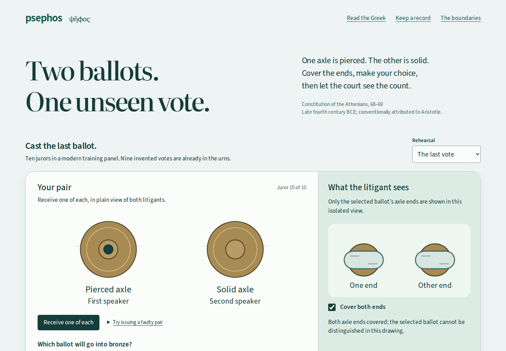
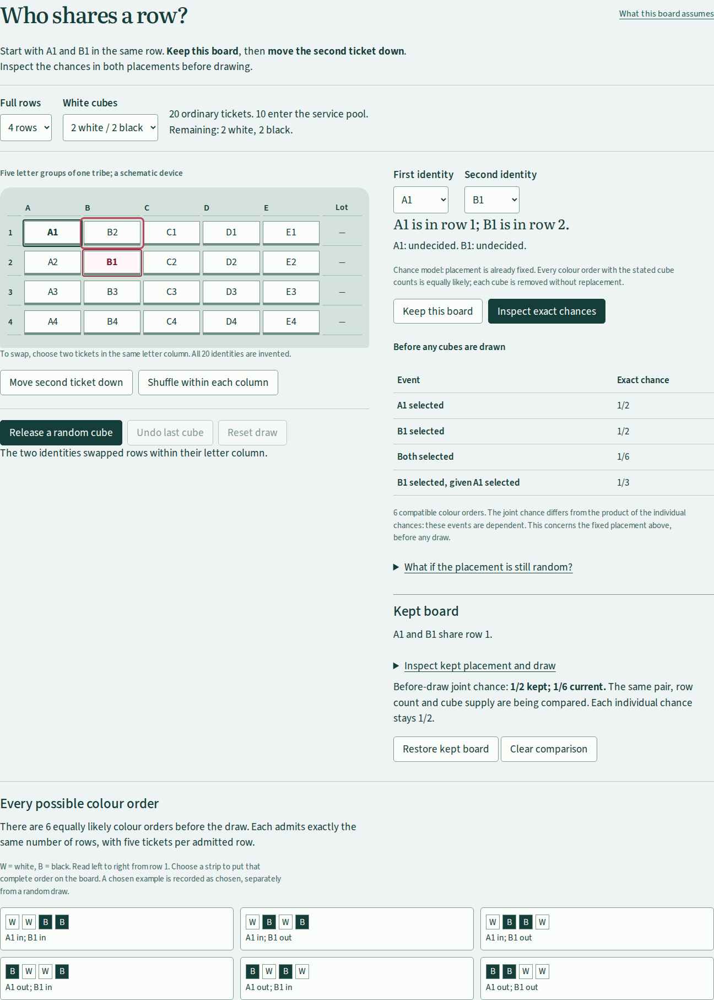
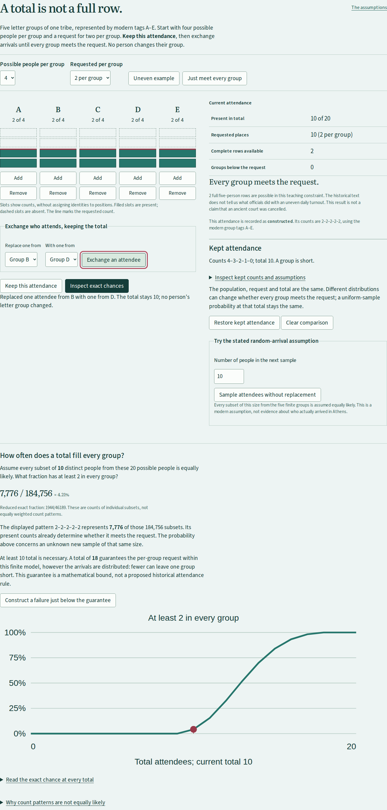
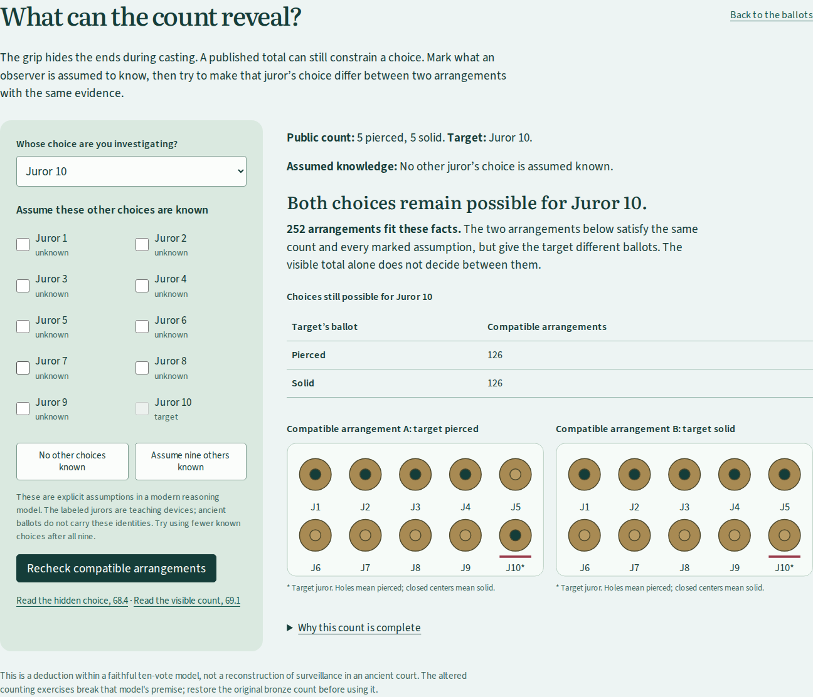

# Psephos

**Who turns up? Who gets selected? What does the count reveal? Operate three Athenian jury experiments and read their Greek.**

[](LICENSE)
[](https://antonsoo.github.io/psephos/)



[Open the workbench](https://antonsoo.github.io/psephos/) · [Audit and reproducible work](docs/audit.md)

A pierced axle supports the first speaker. A solid one supports the second.
Both fit under the same grip. The chosen ballot goes into bronze, the unused
one into wood. Count the wrong urn and you can reverse the apparent result.
Replace a ballot and the total can stay right while the result changes.

The ballot workbench follows the procedure described
in _Constitution of the Athenians_ 68.2–69.1. It joins a physical choice, a
counting experiment, a deduction about hidden choices, and a close reading of the Greek.
It does not invent a historical trial to win.

## One cube, five tickets

The [row-selection workshop](https://antonsoo.github.io/psephos/allotment.html#allotment) asks whether two jurors
enter the service pool together. Keep the first board, swap B1 with B2 using the
actual slot buttons, then inspect every possible white/black cube order.

| Four rows, two white cubes | A1 selected | B1 selected | Both selected |
| -------------------------- | ----------- | ----------- | ------------- |
| A1 and B1 share a row      | 1/2         | 1/2         | 1/2           |
| B1 moves to another row    | 1/2         | 1/2         | 1/6           |



A white cube decides a complete five-ticket row. The **placement is already
fixed** in that calculation. Open “What if the placement is still random?” to
change that assumption: independent uniform shuffles of different letter columns
make the two selections independent before placement is known. The text does
not establish those modern shuffle assumptions.

Choose four, six or eight full rows and the white quota, track any two invented
identities, shuffle within columns, release random cubes without replacement,
or apply one of the completely enumerated colour orders as a **chosen** example.
Kept boards retain their own pair, supply, placement and draw. Undo and reset make
this an editable experiment, rather than a receipt of a physical lottery.

Five close Greek/English readings cover the letter groups, ticket inserter,
bronze cubes, his separate inclusion, and the later courtroom allotment. Word
notes explain the role of each phrase. The complete chapter-64 page actually
prints **LXIV** where sequential numbering would suggest LXIII; the next page
also prints LXIV. Both headings remain visible, identified by archive leaf.
The three new pages were independently rendered from the primary PDF and checked
byte for byte, rather than inheriting an earlier source claim.

Save editable JSON, exact CSV, a board SVG or a standalone illustrated reading
with both experiments, all the Greek, fonts, licenses and five full source images.
The reading works without scripts or a connection and prints to PDF. Study links
include both boards and draws; your explanation stays out of the link. The new
page does not autosave.

This models **ordinary tickets on one small device**, not the complete historical
procedure or its jury quota. The text also counts the previously chosen inserter;
he is outside these row probabilities. Columns are letter groups within a tribe,
not five tribes. A–E and the numbers are modern teaching identifiers. Both
selected for service does not mean both assigned to the same courtroom.

[Source, exact model and limits](docs/allotment-model.md) ·
[Review and retained evidence](docs/allotment-review.md) ·
[Editable example](examples/allotment-study.json) ·
[Exact CSV](examples/allotment-study.csv) ·
[SVG board](examples/allotment-board.svg) ·
[Printed reading](examples/allotment-reading.pdf) ·
[Illustrated reading, gzip-compressed](examples/allotment-reading.html.gz).
Decompress the HTML before opening it. The earlier review records its local delivery;
the [attendance and publication audit](docs/attendance-review.md) records the subsequent edition.

## Enough in total. One group empty.

[Who turns up?](https://antonsoo.github.io/psephos/attendance.html#attendance) tests
the assumption hidden by a board of complete rows. Start with attendance
4–3–2–1–0 in five groups. Keep it. Exchange who attends until the same ten people
in total are distributed 2–2–2–2–2. Nobody changes their registered group.



Enough in total need not mean enough in every group. For five groups of four
potential people and a request for two per group, an unknown uniform ten-person
subset meets every group in only **7,776 of 184,756** cases (about **4.21%**).
The 381 count patterns are not equally likely: the balanced pattern represents
7,776 individual subsets; 4–3–2–1–0 represents 96. Inspect every weight, sample
without replacement, and construct the sharp failure one below the guaranteed
total. Keep the comparison, explain it, and export a script-free illustrated
study with complete source pages and editable native files.

This is a small modern finite-population model. Approximately equal registered
groups in 63.4 do not establish equal daily turnout. The text does not explain
what officials did with an insufficient group. The experiment makes that
uncertainty visible; it does not infer a historical turnout rate or court closure.

[Model and proof](docs/attendance-model.md) · [Audit evidence](docs/attendance-review.md) ·
[Editable study](examples/attendance-study.json) · [Weighted CSV](examples/attendance-study.csv) ·
[Count SVG](examples/attendance-counts.svg) · [Printed reading](examples/attendance-reading.pdf) ·
[Illustrated reading, gzip-compressed](examples/attendance-reading.html.gz).

## Try it

From this checkout, with **Node 24 or later**:

```sh
npm ci
npm run check
npm run dev
```

Open **http://127.0.0.1:4382/psephos/** for ballots, or
**http://127.0.0.1:4382/psephos/allotment.html** for row selection, or
**http://127.0.0.1:4382/psephos/attendance.html** for attendance.
For a production preview:

```sh
npm run build
npm run preview
```

Open **http://127.0.0.1:4381/psephos/**. Build output is **`dist/`**, using
base **`/psephos/`**; `index.html`, `allotment.html` and `attendance.html` are entry points. Development uses a separate origin and installs no worker.
The complete edition can be read offline after the production footer confirms
that every file is retained. Production is served from `gh-pages`; source checks,
clean-build identity and hosted-browser evidence are recorded separately in the
[audit](docs/audit.md).

## Investigations

| Investigation              | Try this                                                               | What changes                                                                          |
| -------------------------- | ---------------------------------------------------------------------- | ------------------------------------------------------------------------------------- |
| The concealed choice       | Receive a pair; pin the observation; change solid to pierced           | The private choice changes, but the covered observer drawing stays identical          |
| The last vote              | Keep solid selected; cast; count bronze                                | Five pierced and five solid: the defendant wins under 69.1                            |
| The wrong urn              | Choose that rehearsal; cast solid; compare bronze with wood            | Bronze has 3 pierced / 7 solid; wood has the unused opposites, 7 / 3                  |
| A total that still matches | Open the first rehearsal's bronze count; replace a solid ballot        | Six pierced / four solid still total ten, but the altered count favors the prosecutor |
| What the count reveals     | After the five–five count, inspect arrangements; mark Jurors 1–5 known | 252 compatible assignments shrink to one; the target must be solid                    |

Ten is a **modern training panel size**, chosen to make equality and counting
legible. It is not an ancient jury size. The earlier votes are invented.
The count remains closed until the panel is complete. Faulty issued pairs are
refused with a source explanation; refused attempts stay in the record.

The deliberate counting interventions are separate modern experiments.
They show the limits of a total alone, not that every historical safeguard
was ineffective. No legal outcome is assigned to the unused urn or a count
with an extra ballot.

## What can a count reveal?

The grip hides the ballot ends during casting. That does not establish what
can be deduced from a later public total. The second investigation lets you
choose a target and explicitly mark which other choices an observer is assumed
to know. It displays exact counts and alternative arrangements that give the
target different choices while satisfying the same evidence.

| Five–five count; target Juror 10 | Compatible arrangements | Target pierced | Target solid |
| -------------------------------- | ----------------------: | -------------: | -----------: |
| No individual choices known      |                     252 |            126 |          126 |
| Four pierced choices known       |                       6 |              1 |            5 |
| All five pierced choices known   |                       1 |              0 |            1 |

Nine known votes are sufficient, but sometimes fewer are enough. A unanimous
count fixes every vote without any other individual choice being known. These
are logical possibilities, **not probabilities** or a reconstruction of ancient
surveillance. Juror labels are teaching devices; the ancient ballots do not
carry these identities. The deduction requires one faithful vote per juror;
the app refuses to apply it to the wrong urn or an altered count.



## Read what makes the procedure work

Five selections pair Greek with new close English and 25 contextual phrase
notes. Select _κύριος_ to see why the urn is authoritative, _πιέζων_ to examine
the grip, or _ἂν δὲ ἴσαι_ to follow the condition that settles a tie.
The juror's role, the material, the destination and the winning side are
different facts; the reader keeps their vocabulary separate.

Two complete printed text pages retain the surrounding text and critical apparatus.
The high-resolution image can be enlarged and panned with arrow keys. The
transcription follows that particular print, preserving editorial supplies
and the double-bracketed gloss in the counting passage. A retained Perseus
XML provides a comparison with different editorial readings. The viewer also
retains the title and imprint: Kenyon’s edition was first published in 1920;
the scanned imprint lists reprints through 1958.

The real bronze ballots appear in a photograph of the Museum of the Ancient
Agora. Its author, date, image changes and CC BY-SA license remain attached
on the page and in the saved record.

[Source-to-action mapping and transcription audit](docs/source-and-model.md).

## Keep the evidence

| Artifact             | Preserved contents                                                                                                                                                  |
| -------------------- | ------------------------------------------------------------------------------------------------------------------------------------------------------------------- |
| Editable JSON        | Starting rehearsal, every accepted or refused attempt, pinned observation, observer assumptions, explanation and chosen citations; counts are recomputed            |
| Explicit shared link | The same record in the URL fragment, including private choices and written notes; editing never rewrites the address bar                                            |
| SVG                  | Current board, count or closed state, source reference and training-panel boundary                                                                                  |
| Illustrated HTML     | The complete rehearsal, explanation, readings, phrase notes, both text pages, title, imprint, photograph, fonts, licenses, provenance and native JSON/SVG downloads |
| PDF                  | Print the illustrated HTML; a browser-generated example is retained below                                                                                           |

The HTML has no scripts and makes no asset requests when opened. Source,
font and license bytes are checked before embedding. The snapshot is taken
when Save is pressed, so continued work cannot change the pending export.
Preparation can be canceled. Failed or stalled source loads leave the live
work intact. A delayed import cannot overwrite work changed during file reading.

Browser storage keeps the current rehearsal when available. Undo/redo applies
to procedural actions; restarting keeps the explanation and citations. Save
a separate file for a durable copy. Version 1 records reopen with their actions,
notes and citations preserved; version 2 adds observer assumptions.

Actual browser-generated examples:
- [Editable last-vote rehearsal](examples/last-vote-record.json)
- [Count diagram](examples/last-vote-count.svg)
- [Complete illustrated record, gzip](examples/last-vote-record.html.gz)
- [Printed record, PDF](examples/last-vote-record.pdf)

To open the retained illustrated record:

```sh
gzip -dk examples/last-vote-record.html.gz
```

Open `examples/last-vote-record.html` in a browser. Its native editable-record
download reopens in the workbench. These examples contain an explicitly
written sample learner explanation; the software does not grade prose.

## How it works

```text
issued pair -> concealed choice -> bronze / wood -> visible board
                   |                                  |
              pinned view                       strict majority
                   |                                  |
                   +---------- Greek source ----------+
```

The pure inference engine checks all 1,024 labeled assignments. An independent
factorial/binomial oracle checks every count and distribution of assumed known
choices. The two displayed arrangements are witnesses, rather than the basis
for counting possibilities.

The pure reducer in `src/core/model.ts` replays an action record. A cast adds
the chosen ballot to bronze and its opposite to wood. An effective prosecution
win requires strictly more pierced than solid ballots. Equality favors the
defendant. The UI exposes those rules only after the appropriate procedural
step, and never treats a wrong-urn count as a verdict.

Modern interventions are derived views of the original count, so switching
between an extra ballot, a replacement and the original never compounds
alterations. JSON accepts facts and actions, not an imported computed winner.
The source viewer cancels superseded requests and ignores late responses.

The production builder generates an edition from the entire output inventory.
The worker checks length and SHA-256 during installation and when reading
cached files. Offline readiness requires a matching current controller and
complete inventory. All open pages withdraw readiness when storage damage is discovered and recheck
after the entire inventory is verified again. Repeated failure notifications
are coalesced. A damaged cache loses its readiness claim; it is repaired
only with matching edition bytes when the origin becomes available again.

## Verification and limits

`npm run check` runs lint, strict type checking, 13 focused tests, retained
source checks and a production build. The model checks all 1,024 possible
ten-vote assignments for conservation of the paired ballots and the strict
majority rule. A hand-transcribed source-concordance table supplies equality
and majority expectations; this is not independent scholarly review.

With the Playwright Chromium and Firefox binaries available:

```sh
npm run test:browser
npm run test:audit
```

The driver serves the built edition itself and writes to `test-results/browser/`.
It operates both browsers at 1440px and 375px, reads Greek, tests keyboard
controls, saves native files, checks embedded file identities, reopens the
standalone artifact and its editable download, and stops the real origin server
before reloading and exporting again. It also refuses a same-length substituted
scan, repairs a damaged cache, checks late source responses, and tests saving
while the live explanation and observer assumptions change. The independent
audit also tests native image failures, foreign readiness messages, cache
isolation and a waiting edition’s eventual activation.
[Current audit](docs/audit.md); [initial pre-audit review](docs/review.md).

`npm run test:public` independently compares every hosted file with `dist/`
and operates the public edition in both browsers at both widths, including
source-image byte identities, offline unanimity, legacy-record migration and
portable HTML on a phone. It never redirects production requests.

The isolated observer drawing tests only whether the axle ends are exposed.
It does not reproduce anatomy, every sight line, textures, coercion or other
possible clues. The app stores and shares private choices for learning; it is
not a voting system. Its urns and board are schematic, not archaeological
replicas. Physical printing and assistive-technology use by a human remain untested.

## Sources and scope

The primary witness is [Kenyon’s edition, first published in 1920](https://archive.org/details/aristotelisathen00aris),
printed pages LXVII–LXVIII, together with the scanned title and imprint. The work is conventionally attributed to Aristotle;
its individual authorship is debated. The excerpt describes late fourth-century
BCE practice. Psephos does not model juror selection, evidence challenges,
pay-tokens, penalty assessment, all Athenian law, or the trial of Socrates.
Ancient jury participation was restricted and unequal.

The [Canellopoulos Museum's bronze ballot](https://camu.gr/en/item/chalkini-dikastiki-psifos/)
provides an institutional object comparison. The retained photograph is by
[Zde at the Ancient Agora Museum](https://commons.wikimedia.org/wiki/File:Ballots,_ca_300_BC,_AGMA,_225285.jpg),
CC BY-SA 4.0. Its approximate object date is attributed to the photographer.
See the [source notice](public/sources/NOTICE.txt),
[provenance](public/sources/provenance.json) and
[retained file identities](public/sources/manifest.json).

## Contributing and license

New versions are released under the [PolyForm Noncommercial License 1.0.0](LICENSE). It is free for any noncommercial purpose, including personal study, teaching and research, and for use by charities, schools, universities, research organizations and government institutions. Commercial use needs written permission from Anthony Mercer (anthony@praviel.com). Versions up to commit [`2909786`](https://github.com/antonsoo/psephos/tree/2909786) (2026-11-01) were released under the MIT License, and copies of those versions keep it.

See [CONTRIBUTING.md](CONTRIBUTING.md). Code, original diagrams, notes and new
translations are [PolyForm Noncommercial 1.0.0](LICENSE). The historical print is public domain in the
United States. The Perseus comparison XML and the photograph retain CC BY-SA
4.0; fonts retain their SIL Open Font Licenses. Every standalone record carries
these separate notices and licenses.
